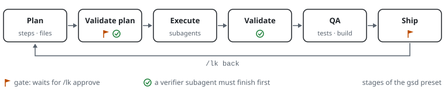
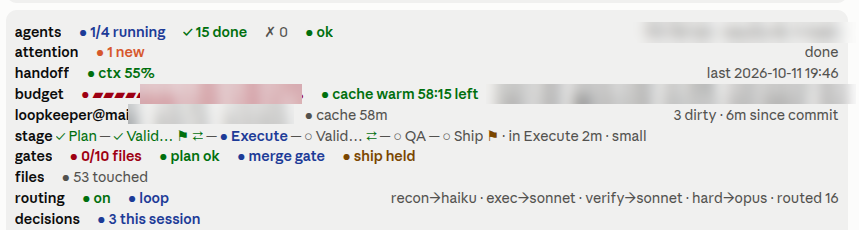
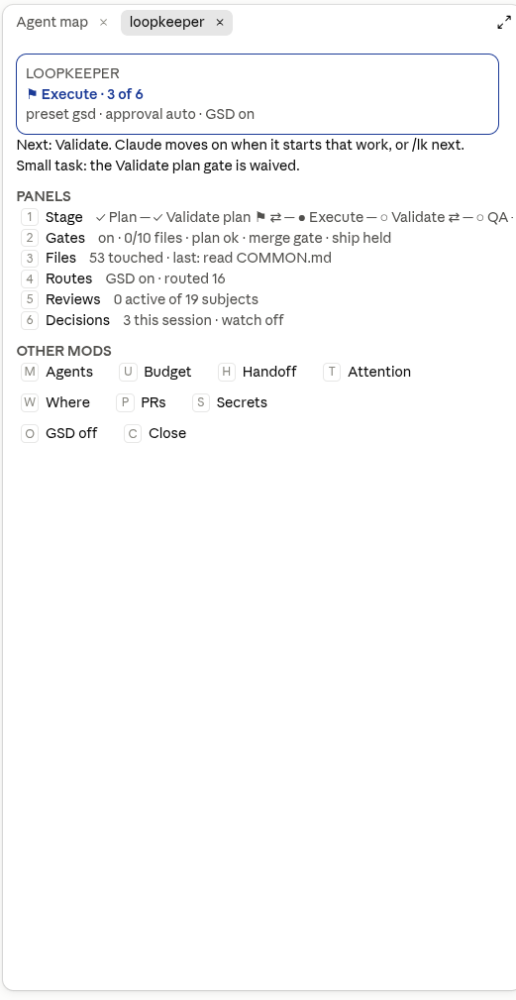
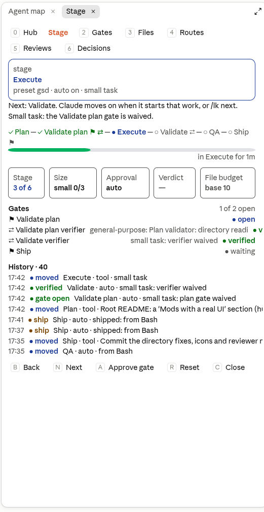
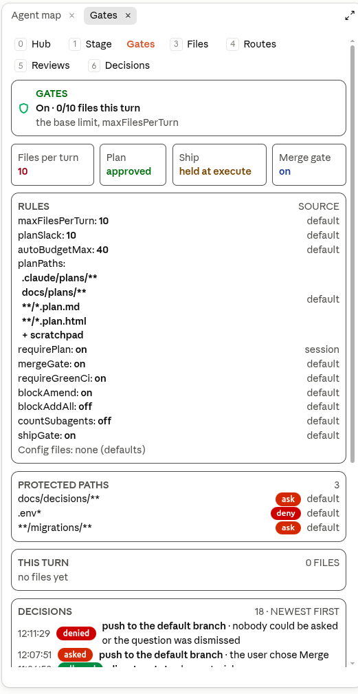
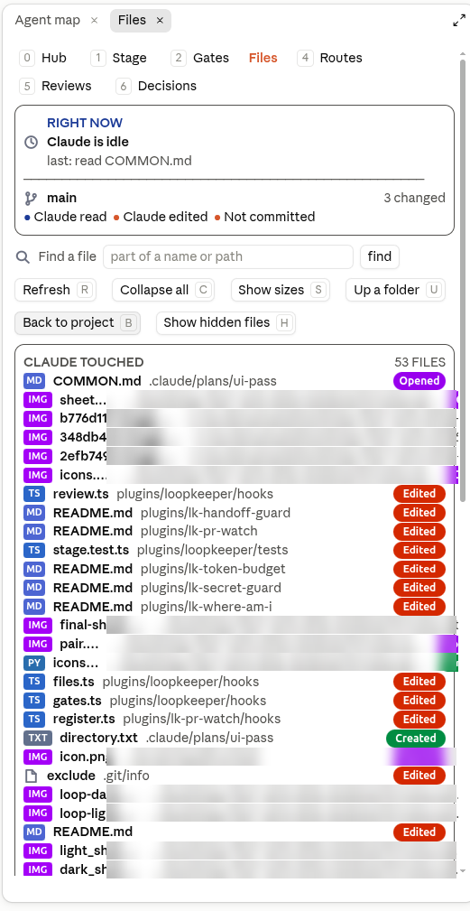
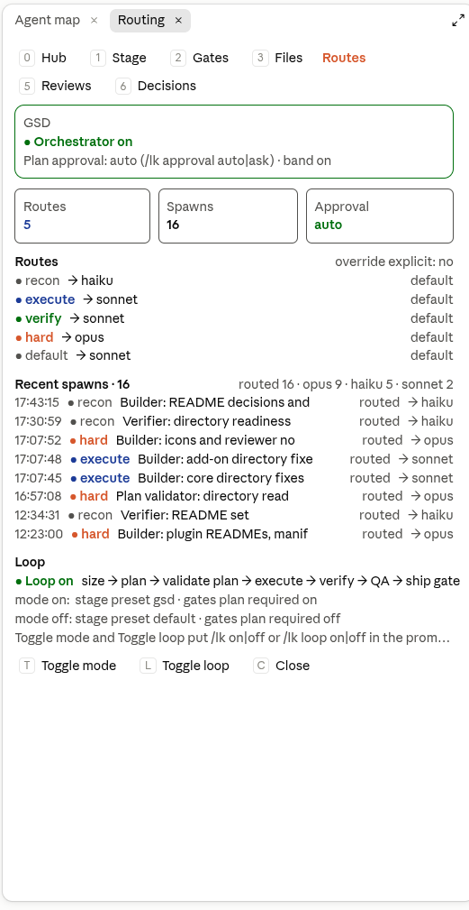
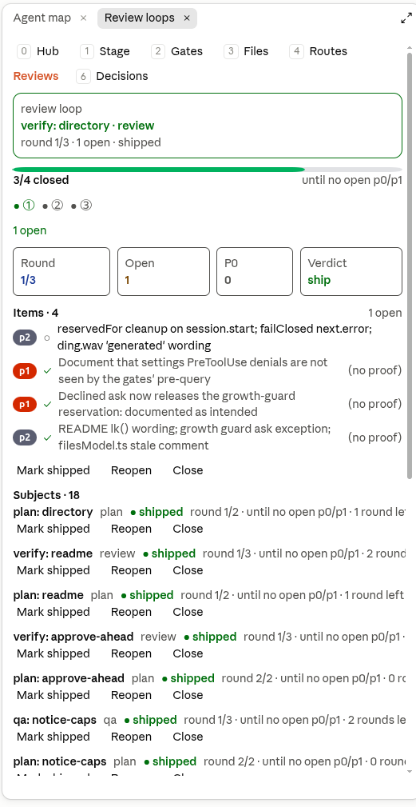
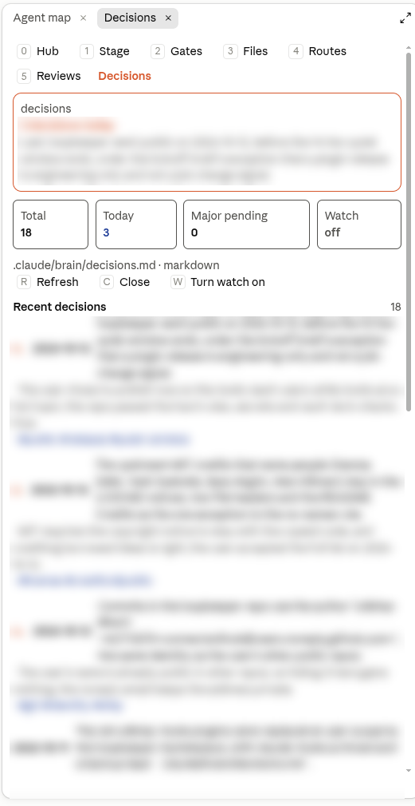
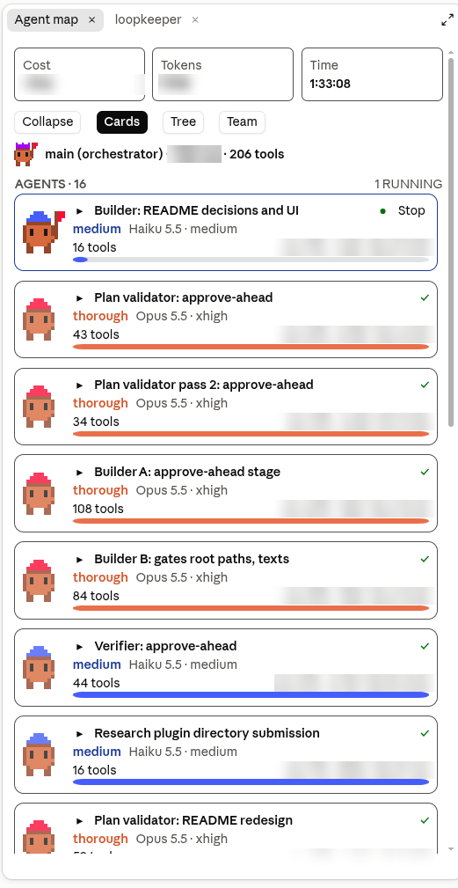

# loopkeeper

**Keep Claude Code on a plan: stages, approval gates and a file budget it cannot talk its way past, plus seven add-on mods.**

For people who hand Claude Code real, multi-file work and want it to plan first, ask before it ships, and stay inside the files it said it would touch.

[](LICENSE)
[](#requirements)
[](https://github.com/connectwithub/loopkeeper/actions/workflows/ci.yml)

<picture>
  <source media="(prefers-color-scheme: dark)" srcset="docs/assets/loop-dark.svg">
  
</picture>

loopkeeper is a set of Claude Code plugins in one repository, which is also their marketplace. The core plugin, `loopkeeper`, runs a task loop (plan, validate the plan, execute, verify, QA, ship) and enforces it with hooks that share state: approval gates, a file budget per turn tied to the approved plan, protected paths, a ship gate, merge and amend guards, model routing by role, bounded review loops and a decision log. A call the rules refuse does not run. The seven `lk-` add-ons are optional: each works with or without the core, and each turns on or off on its own.

**Contents:** [Why loopkeeper](#why-loopkeeper) · [Mods with a real UI](#mods-with-a-real-ui) · [Install](#install) · [A 60-second tour](#a-60-second-tour) · [The plugins](#the-plugins) · [/lk](#lk-the-hub-and-every-command) · [Decisions](#decisions-a-log-that-keeps-itself) · [/agent-map](#agent-map-parts-and-commands) · [Use cases](#use-cases) · [Requirements](#requirements) · [Data handling](#data-handling-and-footprint) · [Turning things off](#turning-things-off) · [FAQ](#faq) · [Contributing](#contributing) · [Credits](#credits) · [License](#license)

## Why loopkeeper

- **Rules, not reminders.** The gates are hooks on tool calls. With the plan requirement on (the GSD loop, or `/lk gates plan required on`), an edit before the plan is approved is refused or asked about; and a commit or push before Ship, a write to `.env*` or a `git commit --amend` on a pushed branch is refused or asked about before it runs, whatever the model decided.
- **A file budget scoped to the plan.** Claude states how many files the plan touches; approving the plan allows that many plus 10 per turn. Past the limit you choose: allow one more, allow the rest of the turn, raise the limit for the session, or stop.
- **Approve once and Claude carries on.** `/lk approve`, the hub's `a` or the band's Approve button opens the gate and sends one prompt that tells Claude to continue from where it stopped. No retyping the task.
- **One hub for every pane.** `/lk` opens a hub with the stage, a row per panel (digits `1` to `6`) and a key for each installed add-on.
- **Take only what you need.** The seven add-ons cover subagents, tokens and the prompt cache, the context limit, alerts, the repo you are in, pull requests and secrets. Each is its own plugin and turns off with one command.
- **Tested and disclosed.** Every plugin has its own test suite, and CI runs them on Claude Code 2.1.294 and, as a canary, on the latest release. No plugin sends telemetry; the core has no network of its own; [SECURITY.md](SECURITY.md) lists what each plugin reads, writes, runs and calls. MIT licensed.

## Mods with a real UI

loopkeeper's plugins are Claude Code mods. A mod is a hooks module that draws inside the session, not only a slash command that prints text. The set draws four kinds of thing:

- **Panes**: a screen of cards, tiles, chips and buttons. The desktop app opens a pane as a panel. The terminal draws the same pane as text.
- **Bands**: one line above the prompt, with a bold label, a few coloured chips and a count or a button.
- **Buttons and single keys**: a band or a pane can carry buttons (Approve, Record, Skip, Write, Stop), and the single keys in a pane press them or switch panel.
- **Toasts and notices**: a short message when something changes, and a dim next-step line in the chat after each answer.

The desktop app, VS Code and mobile draw rounded chips, avatars and progress bars. The terminal draws the same panes as text, with each chip as `● text`. Nothing is left out on the terminal; it is only plainer.

### The hub: `/lk` controls everything

Type `/lk` with no words to open the hub. It shows:

- the **hero**: the stage you are in and the next step, in one sentence;
- a **row per panel**, keys `1` to `6`;
- a **key per installed add-on**: `m` Agents, `u` Budget, `h` Handoff, `t` Attention, `w` Where, `p` PRs, `s` Secrets;
- the **actions**: `a` approves what waits (shown only while something waits), `o` turns loopkeeper on or off, `c` closes the hub.

Every loopkeeper pane starts with a nav row, `0 Hub 1 Stage 2 Gates 3 Files 4 Routes 5 Reviews 6 Decisions`. Press `0` in any pane to go back to the hub, or a digit to switch panel. Claude Code lets a plugin bind keys only inside its own panes and band, so the keys work while a loopkeeper pane has the focus. From the prompt box, `ctrl+x` then `tab` moves the focus to the band or to a pane that opened without it.

An add-on key opens that add-on's pane (for Handoff, `/handoff show`; it never writes a handoff by itself). On the desktop app a press runs the command. On the terminal it fills an empty prompt box with the command for you to send with Enter.

### Every pane in the set

| Pane | Open it with | What you see |
| --- | --- | --- |
| Hub | `/lk` | The stage hero with the next step, the panel rows, the add-on keys and the actions. |
| Stage (`1`) | `/lk stage` | The stage stepper, where the task is, and what waits for you. |
| Gates (`2`) | `/lk gates` | The plan, file budget and ship gates, and the session switches. |
| Files (`3`) | `/files`, or `/lk gates files` | What Claude read and edited this session, and the project tree. |
| Routes (`4`) | `/lk routes` | The model each role's subagents get. |
| Reviews (`5`) | `/reviews` | Each review loop's cycle, score and open items. |
| Decisions (`6`) | `/decisions` | Today's count, the log in use, major decisions waiting for Record or Skip, recent decisions and learned preferences. |
| Agents (`m`) | `/agent-map cards` | A card per subagent with cost, tokens, context, model, effort and progress. Tree and team views too. |
| Budget (`u`) | `/budget` | Tiles for context, cache, cold resend and session cost. |
| Handoff (`h`) | `/handoff show` | The handoff state, the last 10 readings, the last brief and a Write button. |
| Attention (`t`) | `/attention` | The inbox of moments when Claude needed you or finished a long turn, with Mark all seen. |
| Where (`w`) | `/where` | Where you are: repo, branch and worktree, with changed, unpushed, cache and cost tiles. |
| PRs (`p`) | `/pr` | The branch's pull request as a hero, a tile per watched PR, and a card per PR with its checks bar and a link to each check's run. |
| Secrets (`s`) | `/secret-guard` | The last block, blocked and allowed counts, the on or off switch, the last 20 decisions (masked) and the rules. |

### Bands on and off

- The core's bands: `/lk band [stage|gates|files|routing|review|decisions] on|off`. With no name, every core band.
- Each add-on has its own: `/agent-map band on|off`, `/budget band on|off`, `/handoff band on|off`, `/attention band on|off`, `/where band on|off`, `/pr band on|off`, `/secret-guard band on|off`.

## Install

Inside a Claude Code session, add the marketplace once and install the core:

```text
/plugin marketplace add connectwithub/loopkeeper
/plugin install loopkeeper@loopkeeper
```

Or, from a shell, both in one step:

```bash
claude plugin install loopkeeper --marketplace connectwithub/loopkeeper
```

Then add any add-ons you want, one line each:

```text
/plugin install lk-agent-map@loopkeeper
/plugin install lk-token-budget@loopkeeper
/plugin install lk-handoff-guard@loopkeeper
/plugin install lk-attention@loopkeeper
/plugin install lk-where-am-i@loopkeeper
/plugin install lk-pr-watch@loopkeeper
/plugin install lk-secret-guard@loopkeeper
```

Type `/lk` to open the hub. To manage what is installed:

| To | Run |
| --- | --- |
| Turn a plugin off or on again | `/plugin disable <name>@loopkeeper`, `/plugin enable <name>@loopkeeper` |
| See what is installed | `/plugin list` |
| Change settings | `/plugin configure <plugin>` or `/config` for a plugin with settings rows (lk-agent-map); the others read a config file, described in their README |
| Get new versions | `/plugin marketplace update loopkeeper` |

From a shell, `claude plugin` takes the same words, with `--scope user|project|local` to choose where the install is recorded: `claude plugin install lk-attention@loopkeeper --scope project`.

To try a plugin from a clone without installing it, point Claude Code at its folder:

```sh
claude --plugin-dir /path/to/loopkeeper/plugins/loopkeeper
claude --plugin-dir /path/to/loopkeeper/plugins/lk-where-am-i
```

There is nothing else to install: no `npm install` and no build step.

## A 60-second tour

Screenshots from the Claude Code desktop app, taken while this repository was being built with loopkeeper itself. Costs, token totals, paths from the author's machine and the entries of the decision log are blurred. In the terminal the same panes draw as text.

**The band.** One line per concern above the prompt: the stage, the gates, the files touched, routing, decisions and each add-on (agents, attention, handoff, budget, where you are).



**The hub** (`/lk`) and the **Stage** panel (`1`). The hub holds the stage, the next step, a row per panel and a key per add-on. The Stage panel shows the loop, the gates still waiting and the recent history of moves.

<table>
<tr>
<td></td>
<td></td>
</tr>
</table>

**Gates** (`2`) and **Files** (`3`). The rules in force with where each came from, the protected paths, this turn's files and the last 20 gate decisions; then what Claude is reading or editing right now, the branch, and every file Claude touched, with chips for opened, edited and created.

<table>
<tr>
<td></td>
<td></td>
</tr>
</table>

**Routes** (`4`), **Reviews** (`5`) and **Decisions** (`6`). Which model each role runs on and the recent routed spawns; each bounded review loop with its rounds and open items; the project's decision log.

<table>
<tr>
<td></td>
<td></td>
<td></td>
</tr>
</table>

**The agent map** (`/agent-map`, add-on). Tiles over all subagents, then one card per agent: what it is doing, its effort and model, its tool count and progress bar, and a Stop button while it runs.



Text renderings of every pane, for the terminal, are in [docs/renderings.md](docs/renderings.md).

## The plugins

| Plugin | What it does | Command(s) | Use it when |
| --- | --- | --- | --- |
| [`loopkeeper`](plugins/loopkeeper/README.md) (the core) | The stage loop and its approval gates, the plan-scoped file budget, protected paths, ship, merge and amend guards, model routing by role, bounded review loops and a decision log. | `/lk` (`/loopkeeper`), `/files`, `/reviews`, `/decide`, `/decisions` | A change spans many files and you want it planned, checked and approved before Claude edits or ships. |
| [`lk-agent-map`](plugins/lk-agent-map/README.md) | A deck of the session's subagents: cards with cost, tokens, context, model, effort and progress; tree and team views; spawn caps; permission waits; idle alerts; a Stop button per agent. | `/agent-map` | You fan work out to many subagents and want to see them, cap them and stop a runaway one. |
| [`lk-token-budget`](plugins/lk-token-budget/README.md) | A token budget for the session and for each subagent that warns, refuses new subagents or stops tool calls; a prompt-cache timer with Keep warm. | `/budget` | A long multi-agent run must not quietly use up your plan, or you pause long enough for the cache to go cold. |
| [`lk-handoff-guard`](plugins/lk-handoff-guard/README.md) | Watches context fill, writes a session handoff into `.claude/brain/` before the limit, then clears and resumes from it. | `/handoff` | Your sessions run long enough to reach the context limit. |
| [`lk-attention`](plugins/lk-attention/README.md) | A desktop notification, a sound, a toast and an inbox when Claude needs you or finished something long. | `/attention` | You switch windows while Claude works. Linux with GNOME. |
| [`lk-where-am-i`](plugins/lk-where-am-i/README.md) | One line with the repo, branch and worktree, how dirty it is, and the account's usage windows and prompt cache. | `/where` | You run several repos or worktrees at once and want to know which one this session is in. |
| [`lk-pr-watch`](plugins/lk-pr-watch/README.md) | The pull request and CI state of the current branch, toasts on transitions, and a note to Claude when a check fails. | `/pr` | You wait on CI and want Claude to see a red check without you pasting it. |
| [`lk-secret-guard`](plugins/lk-secret-guard/README.md) | Refuses credential-shaped strings, and words on your private deny-list, before they are written into a file or a shell command. | `/secret-guard` | You paste logs, configs or tokens into a session and want them kept out of files and commands. |

Every add-on draws with the core's UI kit, so its band and pane look like the core's. With the core on, the hub's **Other mods** row has one key for each add-on that is installed and on: `m` Agents, `u` Budget, `h` Handoff, `t` Attention, `w` Where, `p` PRs, `s` Secrets. In the desktop app a press runs the add-on's command, which opens its pane. In the terminal it puts the command in an empty prompt box for you to send with Enter, and never replaces a draft. Each plugin's README has its full command list, settings and footprint.

## /lk: the hub and every command

`/lk` (long form `/loopkeeper`) is the way in. With no words it opens the hub. Everything else is a word after it, except `/files`, `/reviews`, `/decide` and `/decisions`. The full reference, with every setting, is in the [core README](plugins/loopkeeper/README.md).

### Hub keys

Claude Code 2.1.294 lets a plugin bind keys only inside its own panes and band, so the keys work while a loopkeeper pane has the focus.

| Key | What it does |
| --- | --- |
| `1` to `6` | Opens a panel: `1` Stage, `2` Gates, `3` Files, `4` Routes, `5` Reviews, `6` Decisions. |
| `0` | From any loopkeeper pane, back to the hub. Every pane starts with the nav row `0 Hub 1 Stage 2 Gates 3 Files 4 Routes 5 Reviews 6 Decisions`. |
| `m` `u` `h` `t` `w` `p` `s` | Opens an add-on: Agents, Budget, Handoff, Attention, Where, PRs, Secrets. Only add-ons that are installed and on have a key. |
| `a` | Approves what waits, as `/lk approve` does, and Claude carries on. Shown only while something waits. |
| `o` | Puts `/lk on` or `/lk off` in the prompt box. |
| `c` | Closes the hub. |
| ctrl+x tab | From the prompt box: focuses the band, or a pane that opened without the focus. |

### Commands

**Moving the pipeline**

| Command | What it does |
| --- | --- |
| `/lk` | Opens the hub. |
| `/lk stage` | Opens the Stage pane. |
| `/lk status`, `/lk text` | The stage, routing and gates; `text` prints plain text. |
| `/lk help` | Lists the keys. |
| `/lk next`, `/lk back` | Moves the task one stage forward or back. |
| `/lk <stage-id>` | Moves to a stage by id, such as `/lk execute`. |
| `/lk size small\|large` | Sizes the task. A small task waives the plan gate and the verifier. |
| `/lk small-max <1-20>` | The small-task file limit for this session (3 by default). A small task that reaches for one more file goes back to Plan. |
| `/lk reset` | Starts the next task: clears the size, verdict, hold, waiver, files and the approved budget. |

**Approvals**

| Command | What it does |
| --- | --- |
| `/lk approve` | Approves the gate or the file budget that waits, from that stage or the one before it, and tells Claude to carry on. |
| `/lk waive` | Waives the gate for the current task. |
| `/lk approval auto\|ask` | `auto` (the default): a validator subagent's consistent verdict opens the plan gate. `ask`: the gate waits for you every time. Kept per project. |

**Gates**

| Command | What it does |
| --- | --- |
| `/lk gates`, `/lk gates text` | Opens the gates pane, or prints the same as text. |
| `/lk gates files`, `/files` | Opens the Files pane: what Claude read and edited this session, and the project tree. |
| `/lk gates max <1-1000>` | Sets a per-turn file limit for this session. |
| `/lk gates plan ok` | Allows edits before a plan, for this session. |
| `/lk gates plan required on\|off` | Turns the plan requirement on or off. |
| `/lk gates plan paths` | Lists the plan-material paths (plans and notes that never count against the gates) and where the list came from. |
| `/lk gates ship ok` | Opens shipping for this session. It also covers the next push or merge to the default branch, once. |
| `/lk gates merge ok` | Allows the next push or merge to the default branch, once. |
| `/lk gates allow <path>` | Allows a protected `ask` path for this session. |
| `/lk gates ship gate on\|off` | Turns the ship gate on or off. |
| `/lk gates on\|off` | Every gate at once, for this session. |
| `/lk gates reload`, `/lk gates band on\|off` | Re-reads the config; shows or hides the gates band. |

**Routing**

| Command | What it does |
| --- | --- |
| `/lk routes` | Opens the routing pane. |
| `/lk route <recon\|execute\|verify\|hard\|default> <haiku\|sonnet\|opus\|model-id>` | Sets the model for a role's subagents. Kept until reset. |
| `/lk route reset` | Drops every `/lk route` override. |
| `/lk explain <text>` | Says which role and model a subagent with this description would get. |

**Reviews**

| Command | What it does |
| --- | --- |
| `/reviews` | Opens the review pane: each subject's cycle, score and open items. |
| `/reviews text`, `/reviews status [subject]` | Prints every loop, or one subject's. |
| `/reviews kinds`, `/reviews kind <subject> <critic\|review\|plan\|qa\|copy\|design>` | Lists the loop kinds, or sets a subject's kind. |
| `/reviews target <n> [subject]`, `/reviews max <n> [subject]` | Sets the target score or the most passes, by default or for one subject. |
| `/reviews ship\|reopen\|stop <subject>`, `/reviews clear <subject>` | Marks a loop shipped, reopens it or stops it; `clear` removes it. |
| `/reviews band on\|off`, `/reviews context on\|off` | Shows or hides the review band, or the review-loop rules in Claude's context. |

**Decisions**

| Command | What it does |
| --- | --- |
| `/decide <decision> -- <why> #tag` | Records a decision in the project's log. |
| `/decide prefs [clear]` | Lists or clears the learned preferences. |
| `/decide watch on\|off\|status`, `/decide watch model <id>` | The decision watch, off by default. When on, it makes model calls on your session. |
| `/decisions`, `/decisions text`, `/decisions reload`, `/decisions band on\|off` | Opens the decision pane, prints it, re-reads the log, or shows or hides its band. |

**Bands and settings**

| Command | What it does |
| --- | --- |
| `/lk on\|off` | GSD mode (the orchestrator rules and spawn routing). |
| `/lk loop on\|off` | The loop. With GSD mode on, it switches to the `gsd` preset and requires a plan. |
| `/lk preset <name>` | Sets the stage preset for the project: `default`, `gsd` or one of your own. |
| `/lk auto on\|off` | Automatic stage moves. |
| `/lk band [stage\|gates\|files\|routing\|review\|decisions] on\|off` | Shows or hides one band line, or all of them. |
| `/lk reload` | Re-reads `loopkeeper.json` from `~/.claude/` and `<project>/.claude/`. |

### The two presets

- **`default`**: Plan → Build → QA → Ship. No gates and no verifier.
- **`gsd`** (the diagram above): Plan → Validate plan (gate, validator) → Execute → Validate (verifier) → QA → Ship (gate). `/lk on` selects it while the loop is on; `/lk loop on` does so only while GSD mode is on.

### The tools Claude uses

The core registers five tools, named `mcp__loopkeeper__<name>`. Claude calls them; you never need to.

| Tool | What it does |
| --- | --- |
| `set_stage` | Moves the stage, sizes the task, records the plan's file count or a validator's verdict. |
| `review_cycle` | Records one pass of a review loop (critic, review, plan, qa, copy or design). |
| `review_item` | Adds an open review item, or closes one with a proof. |
| `review_status` | Shows one subject's loop state, or all of them. |
| `record_decision` | Appends a decision to the project's log. |

## Decisions: a log that keeps itself

A project makes choices all the time: a library, a data model, a naming rule, a trade-off. Without a record, the next session, a subagent or a teammate asks the same question again and argues it out again. The decision log keeps each choice with its reason, in a file in your repo, so the answer stays put.

### Where the entries go

The log is found in this order, and the first file that exists is used:

1. `docs/decisions/decisions.jsonl`
2. `.claude/brain/decisions.md`
3. `brain/decisions.md`
4. `DECISION_JOURNAL.md`

If none exists and `docs/decisions/` holds ADR files (`ADR-0001-…` or `0001-….md`), a new `docs/decisions/decisions.jsonl` is started there. Otherwise the log is `.claude/decisions.jsonl`.

To choose the file yourself, set these in `<project>/.claude/loopkeeper.json`, under `decisions`:

- `file`: a path inside the project, such as `docs/decisions/decisions.jsonl`.
- `format`: `jsonl`, `markdown` (`brain-md` is accepted as an alias) or `journal-md`.

Both are read from the project file only. Each write appends one entry. A write that would change text already in the file is refused.

### How entries get there

- **Claude records them.** `record_decision` is a tool every session has. With GSD mode on, Claude's rules tell it to record each settled decision with that tool, right after the choice is made. Each entry keeps the decision, the why, the tags, the date and the session.
- **You record them.** `/decide <decision> -- <why> #tag #tag`. The `-- <why>` and the tags are optional.
- **The watch** (optional, off by default) reads your turns and proposes entries. See below.

### The Decisions pane and band

The band above the prompt shows `decisions  N this session`, with a `watch on` chip while the watch runs. Key `6` in the hub, or `/decisions`, opens the pane: decisions today, the log in use, major decisions waiting for Record or Skip, the last 20 decisions, the learned preferences and the watch button. `/decisions text` prints the list in the chat. `/decisions band on|off` hides or shows the band.

### Learned preferences

`/decide prefs` lists the preferences the watch has learned for this project, newest last. `/decide prefs clear` forgets them. Only the watch adds them, and only from things you showed or said, such as "Prefer small commits".

### The decision watch

The watch is off by default. Turn it on with `/decide watch on`, or set `decisions.watch` to `true` in the config. `/decide watch status` shows its state, and `/decide watch model <haiku|sonnet|model id>` picks its model (`haiku` by default).

When it is on, a turn is read only if it has at least 200 characters and a cue word such as "decide", "use", "prefer", "switch" or "convention". The last prompt and answer of that turn, the recent logged decisions and the learned preferences go to the model on your own session, through Claude Code. The watch makes at most 20 calls an hour across sessions.

- A **minor** decision (naming, a local default, a small trade-off) is recorded at once, with one toast.
- A **major** decision (an architecture, library, framework or data-model choice, an API contract, security, a convention for the project, anything costly to reverse) waits in the band as a card with **Record** (`r`) and **Skip** (`s`). A skipped decision is never offered again for that project.

### Why it helps

Say a session settles on a SQLite cache because the app runs on one machine. The choice and its reason go into the log, and the band reads `decisions  1 this session`. Months later a new session suggests a network cache. The entry is there with its reason, so the answer is a short look at the file, not a new debate. If the reason no longer holds, the team changes the decision on purpose, and the log shows what was decided and why.

## /agent-map: parts and commands

`/agent-map` comes with [lk-agent-map](plugins/lk-agent-map/README.md). It opens a pane and keeps a band line above the prompt. The parts:

- **Tiles row.** Cost (the sum of the agents' estimates), Tokens and Time (wall-clock time while at least one subagent ran) over the session's subagents, then the **Collapse**, **Cards**, **Tree** and **Team** buttons.
- **Cards.** One per agent, running first. Each card has:
  - an **avatar**: a pixel critter drawn as Svg in the desktop app, with a hat in the effort's colour (the main loop wears a crown); the role glyph in the terminal;
  - the **title**, the status (running, waiting on you, done, failed, stopped, aborted) and the **Stop** button while it runs;
  - the **effort** word and the model it actually ran on, such as `careful Opus 5.5 · high`;
  - the **steps** from the agent's own task list (`4/5 · Signup`), or its tool count;
  - a **progress bar** in the effort's colour;
  - **cost, tokens and context**: context fill, tokens, a cost estimate from list prices, and elapsed time.

  `▸` opens a card's details: its prompt excerpt, tool counts, last activity and how many tokens its result sent back to the main context.
- **Planned.** Agent calls whose subagent has not started yet, such as one waiting for a permission answer.
- **Tree.** Who spawned whom, one row per agent, with forks (`⑂`) and teammates (`◇`) marked.
- **Team lanes.** Agents grouped in lanes by parent, teammates in a lane of their own.
- **Log.** Lifecycle events: spawned, denied by a cap, waiting on you, idle, stopped or muted, returned, done, failed. The pane shows the last 12.
- **Caps block.** Each spawn cap's value and where it came from: the default, the settings, a config file or a command.
- **Stop button.** The first press arms it (the label turns to **Confirm stop**); it disarms by itself after 5 seconds. A second press within those 5 seconds calls Claude Code's own `TaskStop` for that agent. If `TaskStop` refuses, the agent is muted instead: its further tool calls are refused with a request to return its result now.
- **Band.** `agents  ● 3/4 running  ✓ 5 done` with the subagents' tokens and the results sent back to main (example figures). It turns to `● near cap` near a cap and red at one.

It also marks an agent that waits on your permission answer and alerts on one that has been idle for 5 minutes.

| Command | What it does |
| --- | --- |
| `/agent-map`, `/agent-map open` | Opens the pane and focuses it. |
| `/agent-map cards`, `tree`, `team` | Switches the view and opens it; `/agent-map view <cards\|tree\|team>` does the same. Saved between sessions. |
| `/agent-map log` | Prints the last 40 lifecycle events. |
| `/agent-map text` | Prints the chosen view as plain text, for the mobile app or anywhere panes don't draw. |
| `/agent-map clear` | Removes finished agents; running ones stay. |
| `/agent-map band on\|off` | Shows or hides the band. |
| `/agent-map cap concurrent <n>`, `turn <n>`, `session <n>` | Sets a spawn cap; `0` turns it off. |
| `/agent-map cap returned <k>` | Sets the budget for subagent results that reach the main context, in thousands of tokens. |
| `/agent-map cap warn <0.1-1>` | Sets the share of a cap at which it warns. |
| `/agent-map cap grace <ms>` | Sets how long a permission ask stays open before the card shows it waiting. |
| `/agent-map cap reset [kind]` | Clears what `/agent-map cap` saved, for one kind or all; the settings or defaults come back. |

Its six rows in `/config` (the `lk-agent-map` rows; `/plugin configure lk-agent-map@loopkeeper` works too):

| Setting | Default | What it does |
| --- | --- | --- |
| `maxConcurrent` | `4` | Subagents running at once. `0` means no cap. |
| `maxPerTurn` | `8` | Subagents per main-loop turn. `0` means no cap. |
| `maxPerSession` | `40` | Subagents per session. `0` means no cap. |
| `warnAtPercent` | `75` | Warn at this share of a cap, 1 to 100. |
| `maxReturnedTokens` | `150000` | Tokens subagent results may add to the main context per session. It warns; it never refuses a spawn. |
| `stuckAfterMs` | `300000` | How long a running agent may go without a tool call or model request before the idle alert. `0` turns it off. |

A spawn past a cap is refused with a message that tells Claude to wait or batch the work. A spawn that carries `[cap-override: <reason>]` asks you first.

## Use cases

**Keep a large change on plan.** Turn on GSD mode and the loop with `/lk on` and `/lk loop on`. Claude sizes the task and writes the plan with its file count; a validator subagent checks the plan before any work file can be edited; the turn's file limit becomes the planned count plus 10; commits, pushes and PRs wait at Ship until you run `/lk approve`. Want to read every plan yourself? `/lk approval ask`. Uses: loopkeeper.

**Protect folders that need a human.** By default an edit under `docs/decisions/**` or `**/migrations/**` needs your yes first (the terminal asks; in the desktop app you run `/lk gates allow <path>`) and a write to `.env*` is refused. Add your own globs to `changeControl.protected` in `loopkeeper.json`. The merge gate holds `gh pr merge` while checks fail, and a push or merge to the default branch until you say yes: approving Ship (`/lk approve`) or `/lk gates merge ok` covers the next one, and otherwise the terminal asks. `git commit --amend` on a pushed branch is refused. Uses: loopkeeper (`/lk gates`).

**Fan work out to many subagents.** The loop's Execute stage runs through subagents, and spawn routing picks each one's model by role (`/lk routes`, `/lk route verify sonnet`). `/agent-map` shows every agent's progress, cost and context, caps how many run at once, and stops a runaway agent. `/budget agent <n>` limits each one's tokens. Uses: loopkeeper, lk-agent-map, lk-token-budget.

**Work past the context limit.** lk-handoff-guard watches context fill. At 85% by default it asks to write a handoff into `.claude/brain/`, then clears the session and resumes from the handoff. `/handoff mode auto` does it without asking, and `/handoff` writes one now. Pair it with `/budget` to see what a cold prompt cache would cost after a long pause. Uses: lk-handoff-guard, lk-token-budget.

**Wait on CI without watching it.** `/pr` shows the branch's pull request and its checks; when a check fails, it adds a note naming the check and its run, which Claude reads on its next turn. `/pr add <number>` watches another PR. lk-attention notifies you when Claude then needs you. Uses: lk-pr-watch, lk-attention, and the core's merge gate.

**Keep secrets out of files and commands.** lk-secret-guard scans the new text of every write, edit and shell command, from Claude or a subagent. A credential-shaped string is refused; a weaker match asks you; values are shown masked and never stored. `/secret-guard test <text>` shows what it would do. Uses: lk-secret-guard.

**Step away while Claude works.** lk-attention sends a desktop notification and a sound when a permission prompt or a question waits, or when a turn longer than 20 seconds finishes, and keeps them in the `/attention` inbox. lk-where-am-i's line tells you which repo, branch and worktree a session is in when you come back to several. Uses: lk-attention, lk-where-am-i.

## Requirements

- **Claude Code 2.1.294 or later**, for the core and every add-on.
- **lk-attention**: Linux with GNOME, `notify-send`, and `paplay` or `pw-play` for the sound.
- **lk-pr-watch**: the GitHub CLI, `gh`, signed in.
- **lk-where-am-i**: the usage-window chips need a Claude subscription; the rest of its line works without one.
- **Any surface.** No pane is desktop-only. The desktop app, VS Code and mobile draw Svg chips, avatars and bars; the terminal draws the same panes as text. Commands such as `/lk text` and `/agent-map text` print into the transcript where panes don't draw.

## Data handling and footprint

No plugin sends telemetry or collects personal data. Settings and state stay on your machine: in Claude Code's own state and plugin store, and in config files named after each command in `~/.claude/` and `<project>/.claude/` (for example `loopkeeper.json`; lk-where-am-i reads the user file only). They stay until you delete them.

| Plugin | Processes it runs | Model calls | Network | Files it writes |
| --- | --- | --- | --- | --- |
| `loopkeeper` | Read-only `git` and `gh` queries, for the merge gate and the Files pane | Only the decision watch, off by default | None of its own; `gh` reaches GitHub | The review log `.claude/loopkeeper-review.jsonl` and the project's decision log |
| `lk-agent-map` | None | None | None | None. **Stop** calls `TaskStop` only after your second press. |
| `lk-attention` | `notify-send` (when the host has no notification call), `paplay` or `pw-play` | None | None | None. Notifications carry the Bash command or question, clipped, and the desktop keeps them in its history. |
| `lk-handoff-guard` | Read-only `git rev-parse` and `git log` | One per handoff | None of its own | Four notes in `<project>/.claude/brain/` |
| `lk-token-budget` | None | **Keep warm** only: one small request per press; the automatic keep-warm is opt-in and capped | None of its own | None |
| `lk-where-am-i` | Read-only `git`, each run capped at 2 seconds | None | None | None |
| `lk-pr-watch` | `gh pr view` and `gh api graphql`; `xdg-open` or `open` when you press **Open in browser** | None | GitHub, through your `gh` sign-in | None |
| `lk-secret-guard` | None | None | None | None. Matched values are shown masked and never stored. |

Model calls run on your own Claude Code session and spend tokens from your account. Besides these, the core submits one prompt after you approve something that was waiting, so Claude carries on, and lk-handoff-guard clears the session and submits one resume prompt after a handoff that clears. [SECURITY.md](SECURITY.md) has the full list per plugin, and each plugin's README has a Footprint section; SECURITY.md summarises them.

## Turning things off

- **The core's kill switch.** `CLAUDE_MODS_DISABLE=loopkeeper` (or `all`) in the environment turns off the core's enforcing hooks: the gates, the growth guard, spawn routing and the Files pane's tracking. The commands still register, so `/lk` can explain the state. It applies to the core only.
- **An add-on.** The add-ons don't read that variable. Turn one off with `/plugin disable lk-<name>@loopkeeper`, and back on with `/plugin enable lk-<name>@loopkeeper`.
- **For one session.** `/lk gates off` turns off every gate; `/lk off` turns off GSD mode, which is a different switch. Several add-ons have their own: `/budget off`, `/attention off`, `/secret-guard off`, `/handoff mode off`.
- **Just the band.** `/lk band off`, `/agent-map band off`, and `band off` after any add-on's command.
- **Failing closed.** If a gate hook errors, the call is refused with a message that names both switches above. Spawn routing fails open: on an error the subagent starts with the model it was given.

## FAQ

**Can I use only the add-ons?** Yes. Each add-on works without the core, and its command is its own. The hub and its keys come with the core.

**Does it slow Claude down?** The checks are local hook code that runs on tool calls, with no network of their own. What you notice are the stops you keep: the plan approval, the ship approval, and the question when a turn goes past its file limit. Small tasks (`/lk size small`) skip the plan gate and the verifier, and `/lk approval auto` lets a validator's consistent verdict open the plan gate without you.

**How do I turn a gate off for one session?** `/lk gates off` turns off all of them. For one gate: `/lk gates plan ok`, `/lk gates ship ok`, or `/lk gates max <n>` for the file limit.

**Does Claude know about the loop?** Yes. With GSD mode on, the core adds the loop's rules to Claude's context and gives it the five tools above. A refused call comes back with a message that names the next step, such as `/lk approve`.

**Where do the settings live?** The core reads `loopkeeper.json` in `~/.claude/` and in `<project>/.claude/`, the project file winning. Each add-on reads a config file named after its command, such as `~/.claude/pr-watch.json`, and lk-agent-map also has rows in `/config`. Each plugin's README lists its keys and defaults.

**Can I go back a stage or start over?** `/lk back` moves one stage back, `/lk <stage-id>` jumps to a stage, and `/lk reset` clears the task for the next one.

## Contributing

Issues and pull requests are welcome. [CONTRIBUTING.md](CONTRIBUTING.md) covers the layout, the UI kit, the rules for public strings and how to check a change. In short, from a plugin's folder:

```sh
claude plugin validate --strict .   # manifest, hooks and types; warnings are errors
claude plugin test .                # every tests/*.test.ts
```

At the repository root, `claude plugin validate --strict .` checks the marketplace manifest.

## Repository layout

```
.claude-plugin/marketplace.json   the marketplace: one entry per plugin
plugins/loopkeeper/               the core plugin (hooks, tests, types, README, CHANGELOG, LICENSE)
plugins/lk-<name>/                one add-on plugin each, laid out the same way
docs/                             architecture, the loop, renderings, decision records, the diagram
.github/workflows/ci.yml          validation and tests for every plugin
```

[ADR 0015](docs/adr/0015-core-and-add-ons.md) explains why the set is laid out this way. More reading: [architecture](docs/architecture.md), [the loop](docs/loop.md) with a worked large task, [renderings](docs/renderings.md) of every band and pane, the [decision records](docs/adr/README.md), and [CHANGELOG.md](CHANGELOG.md), which points to each plugin's changelog.

## Credits

Some of the plugins borrow code from MIT-licensed Claude Code mods. Each plugin's LICENSE carries the full notices, and its README names the sources in its Credits (or "Borrowed from") section:

| Plugin | README | Licence |
| --- | --- | --- |
| `loopkeeper` | [README](plugins/loopkeeper/README.md) | [LICENSE](plugins/loopkeeper/LICENSE) |
| `lk-agent-map` | [README](plugins/lk-agent-map/README.md) | [LICENSE](plugins/lk-agent-map/LICENSE) |
| `lk-attention` | [README](plugins/lk-attention/README.md) | [LICENSE](plugins/lk-attention/LICENSE) |
| `lk-handoff-guard` | [README](plugins/lk-handoff-guard/README.md) | [LICENSE](plugins/lk-handoff-guard/LICENSE) |
| `lk-token-budget` | [README](plugins/lk-token-budget/README.md) | [LICENSE](plugins/lk-token-budget/LICENSE) |
| `lk-where-am-i` | [README](plugins/lk-where-am-i/README.md) | [LICENSE](plugins/lk-where-am-i/LICENSE) |
| `lk-pr-watch` | [README](plugins/lk-pr-watch/README.md) | [LICENSE](plugins/lk-pr-watch/LICENSE) |
| `lk-secret-guard` | [README](plugins/lk-secret-guard/README.md) | [LICENSE](plugins/lk-secret-guard/LICENSE) |

## License

MIT. See [LICENSE](LICENSE). Each plugin folder carries its own copy with the third-party notices that apply to it.
